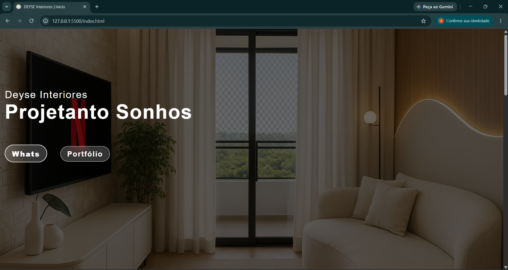

# 🏡 Deyse Interiores

Site institucional desenvolvido para uma **designer de interiores em atividade**, utilizado como sua presença digital oficial para apresentar serviços, portfólio e canais de contato.

**🌐 Site:** https://SEU-LINK-AQUI.com

---

## Sobre o projeto

A Deyse Interiores é um projeto real criado para atender às necessidades de uma profissional da área de design de interiores. O site foi desenvolvido com foco em elegância, responsividade e facilidade de navegação, permitindo que clientes conheçam o trabalho da designer e entrem em contato rapidamente.

## Funcionalidades

- Apresentação da profissional
- Exibição do portfólio de projetos
- Página totalmente responsiva
- Botão de contato via WhatsApp
- Links para Instagram e Pinterest

## Tecnologias utilizadas

- HTML5
- CSS3
- JavaScript

## Preview

## Objetivo

Criar uma presença digital profissional que refletisse a identidade visual da designer e pudesse ser utilizada no dia a dia como seu site oficial.

---

## Desenvolvedor

**Áquila Filemon**